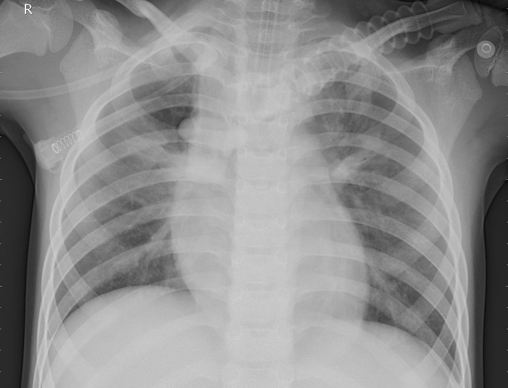
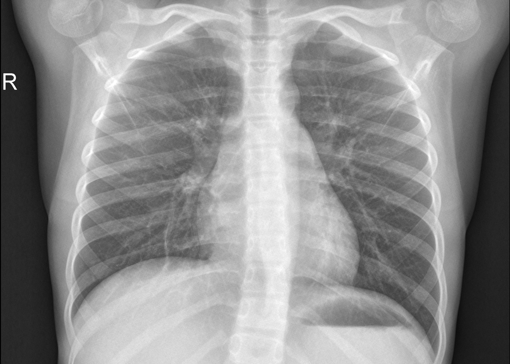

# Pneumonia Detection using Chest X-ray Images

Pneumonia is an inflammatory condition primarily affecting the lungs, characterized by symptoms such as cough, chest pain, fever, and difficulty breathing. The goal of this project is to develop an automated deep learning system for detecting and classifying pneumonia in medical chest radiographs.


---

## Motivation
The motivation behind this project is to leverage artificial intelligence and computer vision to accurately detect and classify pneumonia in humans using chest X-ray images. By automating the screening and diagnostic process, it can aid radiologists and healthcare professionals in providing timely, accessible, and accurate treatment—especially in resource-constrained medical environments.

---

## Approach
A deep Convolutional Neural Network (CNN) architecture was implemented using Python and TensorFlow/Keras to perform binary classification (Normal vs. Pneumonia):
- **Data Augmentation & Preprocessing**: Images are resized to $256 \times 256 \times 3$, normalized, and augmented using `ImageDataGenerator` (random rotations, zoom, shifts, and horizontal flips) to enhance model generalization.
- **Feature Extraction**: Stacked convolutional blocks utilizing `Conv2D` layers (filters ranging from 32 to 128), `BatchNormalization` for stabilizing learning, and `MaxPooling2D` to extract hierarchical spatial features.
- **Regularization & Classification**: `Dropout` layers to mitigate overfitting, followed by `Flatten` and dense hidden layers, culminating in a single-unit `Dense` layer with a **Sigmoid** activation function.
- **Optimization & Loss**: Trained using the **Adam** optimizer and **Binary Cross-Entropy** loss.

---

## Key Technologies Used
- **Python**
- **TensorFlow & Keras**
- **OpenCV**
- **NumPy & Pandas**
- **Matplotlib & Seaborn**
- **Jupyter Notebook**
- **Git Large File Storage (Git LFS)**

---

## Sample Reference Images (Normal vs. Pneumonia)

Below are representative chest X-ray samples from the dataset illustrating the visual distinctions between healthy lung fields and pneumonia-affected lungs:

| Normal Chest X-Ray | Bacterial Pneumonia | Viral Pneumonia |
| :---: | :---: | :---: |
|  |  |  |
| **Normal**: Clear lung fields without abnormal opacification or fluid buildup. | **Bacterial**: Focal lobar consolidation often localized in one segment or lobe. | **Viral**: Diffuse interstitial patterns spread across both lung fields. |

<details>
  <summary>Click to view additional normal reference image</summary>
  <br>
  
</details>

---

## The Dataset
The dataset used in this project is organized into three standard folders: `train`, `test`, and `val`. It consists of anterior-posterior chest X-ray images (JPEG) categorized into two classes: **PNEUMONIA** and **NORMAL**.

Chest X-ray images were obtained from pediatric patients between one and five years old from the **Guangzhou Women and Children's Medical Center**, Guangzhou. All chest radiographs were initially screened for quality control by removing low-quality or unreadable scans. The diagnoses were graded by two expert physicians before being approved for training the AI system. To account for any evaluation errors, the evaluation set was independently verified by a third expert.

The dataset and community code notebooks are available on Kaggle:
👉 **[Kaggle: Chest X-Ray Images (Pneumonia)](https://www.kaggle.com/datasets/paultimothymooney/chest-xray-pneumonia/code)**

> *Note: Due to GitHub file and repository size limitations, the complete ~2.6 GB raw dataset is excluded via `.gitignore`. You can download the dataset directly from Kaggle using the link above and extract it into a `dataset/` directory.*

---

## Achievement
The developed CNN model was trained across multiple epochs, reaching over **97% training accuracy** and demonstrating strong feature extraction capabilities to distinguish normal radiographs from both bacterial and viral pneumonia. This serves as a strong prototype for computer-aided diagnostic (CAD) systems in biomedical imaging.

---

## Project Structure
```text
pneumonia-detection-cnn/
├── sample_images/
│   ├── NORMAL/
│   │   ├── normal_sample_1.jpeg
│   │   └── normal_sample_2.jpeg
│   └── PNEUMONIA/
│       ├── bacterial_pneumonia_sample.jpeg
│       └── viral_pneumonia_sample.jpeg
├── models/
│   └── pneumonia_model.h5          # Trained model weights (~102.7 MB, Git LFS)
├── Pneumonia_detection.ipynb        # Complete training and evaluation notebook
├── .gitattributes                   # Git LFS tracking configuration
├── .gitignore                       # Excludes 2.6 GB dataset and checkpoint files
└── README.md                        # Documentation and guide
```

---

## Getting Started

### 1. Clone the Repository
```bash
git clone https://github.com/Sidd-art-h1/pneumonia-detection-cnn.git
cd pneumonia-detection-cnn
```

### 2. Download Pre-trained Model Weights (Git LFS)
The model weights file (`models/pneumonia_model.h5`) is tracked with Git LFS. To retrieve it:
```bash
git lfs install
git lfs pull
```

### 3. Install Required Libraries
```bash
pip install tensorflow keras numpy pandas matplotlib opencv-python
```

### 4. Run the Jupyter Notebook
```bash
jupyter notebook Pneumonia_detection.ipynb
```

---

## Credit & Citations
- **Dataset Author:** Paul Mooney, [Chest X-Ray Images (Pneumonia) on Kaggle](https://www.kaggle.com/datasets/paultimothymooney/chest-xray-pneumonia/code)
- **Clinical Data Source:** Kermany, Daniel; Zhang, Kang; Goldbaum, Michael (2018), *"Labeled Optical Coherence Tomography (OCT) and Chest X-Ray Images for Classification"*, Mendeley Data, V2, doi: [10.17632/rscbjbr9sj.2](https://doi.org/10.17632/rscbjbr9sj.2)
- **Reference Project:** [inuwamobarak/chest-xray-pneumonia-detection](https://github.com/inuwamobarak/chest-xray-pneumonia-detection)
